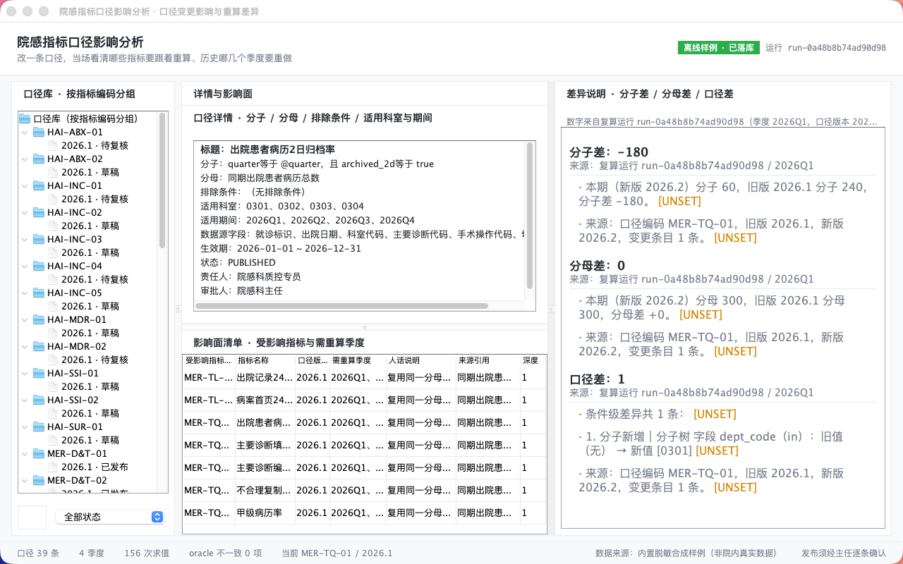
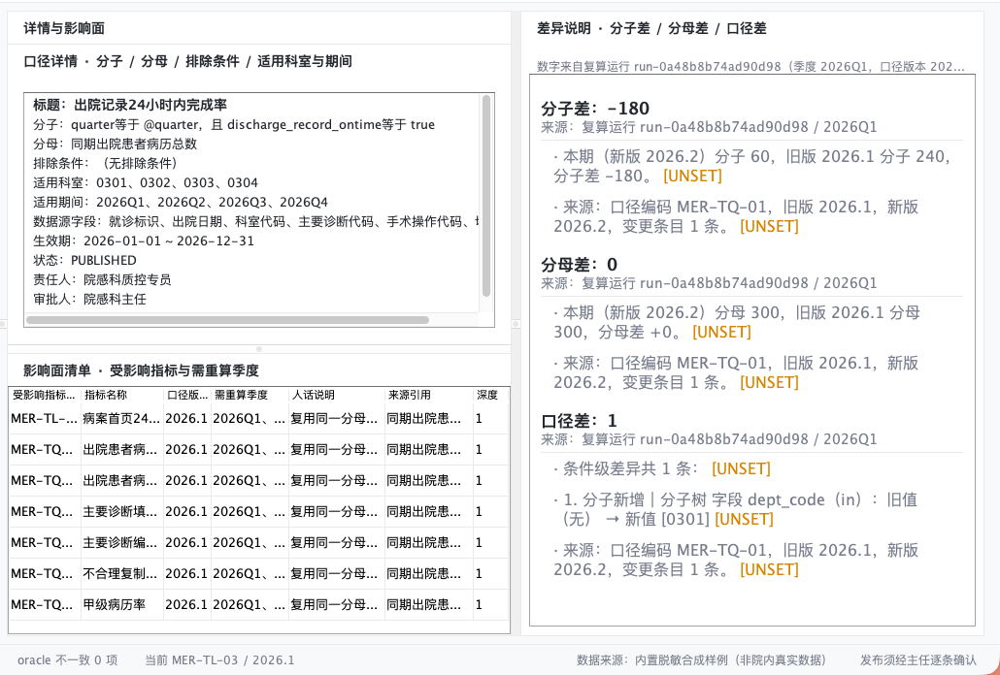
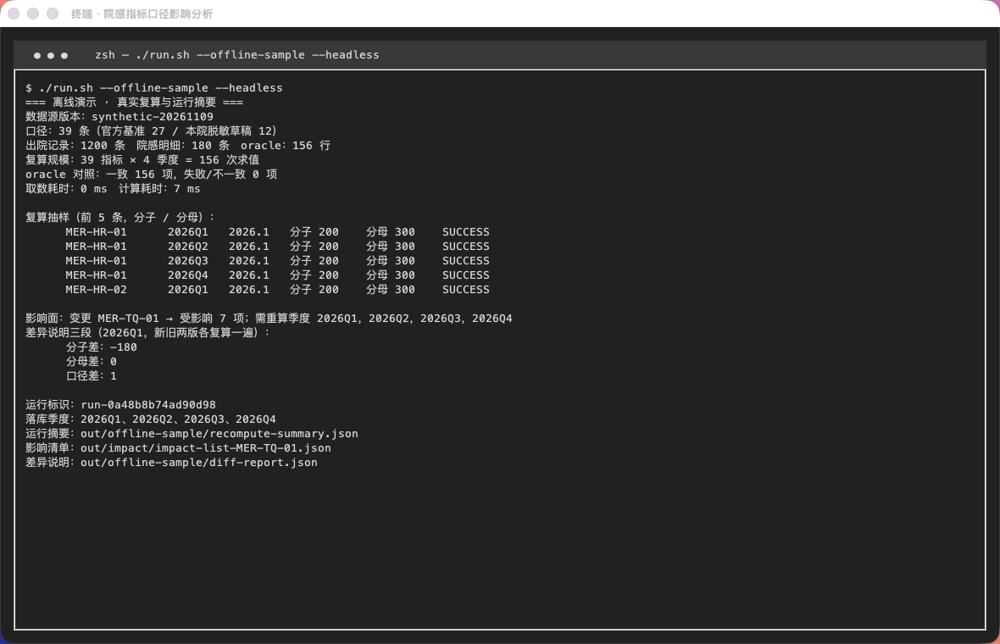

# 院感指标口径影响分析

> 院感科把一条指标口径的分子范围改窄，工具当场列出要跟着重算的其它指标、要重做的历史季度，主任逐条确认后发布回院内质控系统。

一条院感指标口径动了分子范围，影响的从来不只是它自己：复用同一个分母的其它指标要跟着重算，历史季度也要重做。人工做这件事，靠的是翻 Excel、逐条比对、心里默算——慢、漏、说不清。本工具把这三件事接过来：改完口径当场看到影响面，主任在同一个窗口里逐条确认差异，确认后发布回院内质控系统并留下回执。

工具常驻在院感科办公电脑上，以桌面窗口为主入口；命令行只作为运维排障与批量跑批的通道。

## 适用场景 / 目标岗位

| 岗位 | 什么时候用 | 得到什么 |
|------|------------|----------|
| 院感科质控专员 | 上级口径包下发后一两周；本院某条指标口径要改时 | 一份《口径变更影响清单》：哪些指标要跟着重算、历史哪几个季度要重做、每条为什么 |
| 院感科主任 | 专员提交口径草稿后；季度上报前 | 一份《口径变更影响与重算差异说明》：分子差 / 分母差 / 口径差三段，逐条确认后才可推进 |
| 院感科统计员 | 每月、每季度复算与上报前 | 按已发布口径复算出来的上报表，外加一份《复算运行摘要》：哪一步失败、哪条口径还没发布、结果落在哪个季度 |
| 信息科接口工程师 | 口径发布前；上游接口字段变更后 | 字段对账结果：口径声明的字段与数据源实际字段逐条比对，缺失、多余、类型不符分开列出，缺失时直接拦住发布 |

## 能力要点

- **改完口径当场看到影响面**：把一条草稿口径丢进依赖图，直接列出复用同一分母的其它指标，以及按适用期间与已落库结果求交得到的需重算季度——不用再翻 Excel 找。
- **依赖按口径内容匹配，不按名字**：两个只差一个词的官方分母（住院手术患者 / 出院手术患者病历总数）是两个不同口径，工具按口径内容哈希建边，绝不连错边。
- **差异说明是结构化的三段**：分子差、分母差、口径差分栏给出，每条差异带字段名与改前改后的值，可以直接贴进季度上报材料；同一份输入跑两遍，数字逐字一致。
- **状态只能由人推进**：草稿、待复核、已发布、已驳回、已停用五个状态，模型与脚本都只能产出草稿，跳过复核直接发布会被拒绝。
- **发布带幂等键并留回执**：口径发布回院内质控系统时带幂等键，同一版本重复发布不会产生第二条已发布版本，回执按指标编码可反查。
- **失败不静默改数据**：取数失败、字段缺失、区间取数报错时，该指标本次复算显式失败并写进运行摘要，绝不按 0 计入分母。

## 快速开始

### 依赖

- JDK 17（本机推荐 `/opt/homebrew/opt/openjdk@17`，或自行设置 `JAVA_HOME`）
- Apache Maven 3.9+（构建与自检用；院内电脑若只跑成品 jar 则不需要）
- 运行时内存建议 ≥ 512 MB；Swing 桌面环境，Windows 10/11 与主流国产 Linux 桌面均可

### 安装

```bash
cd infection-metric-impact
JAVA_HOME=/opt/homebrew/opt/openjdk@17 mvn -q package -DskipTests   # 构建 fat-jar（依赖已备齐可加 -o 离线构建）
chmod +x run.sh                                                  # 赋权
cp .env.example .env                                            # 复制凭据位模板，令牌不要提交进版本库
```

### 配置

所有凭据与端点地址一律从环境变量读取，工具不硬编码、不打印令牌明文。复制 `.env.example` 为 `.env` 后填写；`run.sh` 启动时会自动装载同目录下的 `.env`（不覆盖已在环境中的同名变量）。完整 13 项见「命令 / API / 配置说明 → 关键配置项」，下面是决定能不能跑起来的四项：

| 配置项 | 默认值 | 说明 |
|--------|--------|------|
| `EMR_BASE_URL` + `EMR_API_TOKEN` | 无 | 读出院记录与字段字典 |
| `HAI_BASE_URL` + `HAI_API_TOKEN` | 无 | 读院感监测明细 |
| `QC_METRICS_BASE_URL` + `QC_METRICS_TOKEN` | 无 | 写口径条目与合并口径包 |
| `LLM_BASE_URL` + `LLM_API_KEY` + `LLM_MODEL` | 无 | 模型服务；不可达时退回人工录入，状态不自动推进 |

### 构建与验证

```bash
JAVA_HOME=/opt/homebrew/opt/openjdk@17 mvn -o -q test      # 跑全部单元测试（离线可跑）
JAVA_HOME=/opt/homebrew/opt/openjdk@17 mvn -o -q package   # 打包出可直接运行的 jar
./run.sh --doctor                                          # 配置与端点自检：凭据位、端点可达性、本地库可读写
```

### 主命令速查

```bash
./run.sh                       # 启动桌面窗口（默认形态，三栏 + 托盘常驻）
./run.sh --headless            # 跑一次复算并打印运行摘要（运维排障 / CI 跑批）
./run.sh --doctor              # 配置项、凭据位、端点可达性、本地库可读写自检
./run.sh --offline-sample      # 离线演示：读脱敏样例（显式开关，非默认路径）
./run.sh --offline-sample --headless   # 离线真跑复算：影响面 + 差异说明 + 运行摘要落盘
./verify.sh                    # 发布前一条命令验收：安装 / 配置 / 测试 / 打包 / 自检
./run.sh --help                # 参数说明
```

## 命令 / API / 配置说明

### 关键配置项

13 项环境变量全部来自环境变量，`run.sh` 启动时自动装载同目录 `.env`；令牌类只显示「已配置（长度 N）」，不打印明文。

| 配置项 | 默认值 | 说明 |
|--------|--------|------|
| `EMR_BASE_URL` | 无 | 院内电子病历接口根地址（读出院记录与字段字典） |
| `EMR_API_TOKEN` | 无 | 电子病历接口访问令牌 |
| `HAI_BASE_URL` | 无 | 院感监测系统接口根地址（读院感监测明细） |
| `HAI_API_TOKEN` | 无 | 院感监测接口访问令牌 |
| `QC_METRICS_BASE_URL` | 无 | 院内质控系统接口根地址（写口径条目与合并口径包） |
| `QC_METRICS_TOKEN` | 无 | 质控系统写入令牌 |
| `REGIONAL_PLATFORM_BASE_URL` | 无 | 区域平台接口根地址（读上级下发的口径包） |
| `REGIONAL_TOKEN` | 无 | 区域平台下载令牌 |
| `LLM_BASE_URL` | 无 | 模型服务根地址（OpenAI 兼容协议，可指向院内自建端点） |
| `LLM_API_KEY` | 无 | 模型服务密钥 |
| `LLM_MODEL` | 无 | 模型名称 |
| `LLM_TIMEOUT` | `30` | 模型调用超时秒数 |
| `LLM_MAX_RETRIES` | `2` | 模型调用重试上限（结构校验失败不重试） |

### CLI 子命令 / 接口端点

| 命令或路径 | 用途 | 关键参数 |
|------------|------|----------|
| `./run.sh` | 启动桌面窗口 | 无 |
| `./run.sh --headless` | 跑一次复算并输出运行摘要 | 无 |
| `./run.sh --doctor` | 环境与端点自检 | 无 |
| `./run.sh --offline-sample` | 离线演示（脱敏样例） | 无 |
| `GET {emr_base_url}/api/v1/encounters` | 读出院记录（分母侧） | `dischargeFrom` / `dischargeTo` / `deptCode` |
| `GET {emr_base_url}/api/v1/metadata/fields` | 读字段字典（发布前对账） | 无 |
| `GET {hai_base_url}/api/v1/infection-reports` | 读院感监测明细（分子侧） | `period` |
| `GET {regional_platform_base_url}/api/v1/indicator-packages/{package_version}` | 读上级口径包 | 路径参数 `package_version` |
| `POST {qc_metrics_base_url}/api/v1/indicator-definitions` | 发布口径条目（真实写） | 头 `Idempotency-Key: sha256(指标编码\|口径版本)` |
| `POST {qc_metrics_base_url}/api/v1/indicator-packages/{package_version}/merge` | 合并口径包（真实写） | 头 `Idempotency-Key: sha256(包版本\|目标口径版本)` |

### 错误与降级

| 场景 | 表现 | 处理方式 |
|------|------|----------|
| 端点连接失败 | 该指标取数失败 | 该指标本次复算显式失败并写入运行摘要；不按 0 计入分母 |
| 端点超时 | 同上，另附超时原因 | 按退避策略重试（上限 3 次，仅对 5xx 与超时重试），仍失败则显式失败 |
| 端点返回 4xx | 报出可读原因（如地址错、令牌过期） | 不重试，直接失败并提示核对配置 |
| 端点返回 5xx | 同上 | 指数退避重试，上限 3 次后失败并记录重试次数 |
| 口径声明了数据源没有的字段 | 报「口径 {编码} 声明依赖字段 {字段}，数据源 {来源} 未提供该字段」 | 该指标显式失败；发布动作被拦截 |
| 口径依赖成环 | 报「口径依赖成环：A → B → C → A」 | 拒绝建图与发布，列出成环链 |
| 模型服务不可达 | 抽取与归因不可用 | 退回人工录入条件树并做规则校验，界面标注「口径来源 = 人工」；状态不自动推进 |
| 模型返回结构不符 | 报具体不合约定的字段 | 不重试（同输入必然同结果），失败写入调用审计 |

### 对接现有系统

| 对端系统 | 方向 | 协议 | 凭据位 |
|----------|------|------|--------|
| 院内电子病历 | 读 | HTTP GET | `EMR_API_TOKEN` |
| 院感监测系统 | 读 | HTTP GET | `HAI_API_TOKEN` |
| 院内质控系统 | **写** | HTTP POST | `QC_METRICS_TOKEN` + `Idempotency-Key` |
| 区域平台 | 读 | HTTP GET | `REGIONAL_TOKEN` |
| 模型服务 | 读 | HTTP（OpenAI 兼容协议） | `LLM_API_KEY` |

写操作只有两个端点，且都必须先经人工确认：口径条目发布、口径包合并。两者都带幂等键，同键重复提交不产生第二条记录，并在本地留下可按指标编码反查的回执。

## 典型场景

### 场景 1：质控专员改窄某季度指标的分子范围

1. 在左侧口径库选中该指标，把分子条件收窄（例如排除切口等级 Ⅲ 的记录），存为新版本草稿。
2. 右侧「详情与影响面」当场展开：哪些指标复用了同一个分母要跟着重算、历史哪几个季度要重做，每条都写明依据。
3. 把影响清单导出为 CSV，附在科室周报后面。

```bash
# 离线真跑一遍：影响面按分母指纹展开，清单落盘（窗口内可再导出 JSON / CSV）
./run.sh --offline-sample --headless
# 产物：out/impact/impact-list-MER-TQ-01.json
```

### 场景 2：主任复核差异说明后发布

1. 窗口切到「差异说明」面板，分子差 / 分母差 / 口径差三段同屏，每条差异可标「已确认 / 有疑问」并写意见。
2. 存在未确认差异时「提交复核」不可用；全部确认后方可提交。
3. 发布走真实出站端点，带幂等键；发布后弹出回执（时间戳、改了哪几条、端点返回标识）。

```bash
# 发布前先自检凭据位与端点可达性；提交复核与发布动作在窗口内经人工确认完成
./run.sh --doctor
# 写端点：POST {qc_metrics_base_url}/api/v1/indicator-definitions，带 Idempotency-Key
```

### 场景 3：上级下发新版口径包后的逐条比对与合并

1. 拉取口径包后逐条比对本院已发布口径，产出三份清单：新增、实质口径变更、本院例外。
2. 实质变更那几条逐条列出条件级差异与业务归因，主任逐条确认或驳回。
3. 确认完才合并；合并中途失败整体回滚，不留半拉子口径。

```bash
# 离线读脱敏口径样例，核对包内条目与本院已发布口径的差异
./run.sh --offline-sample
# 清单落盘：out/offline-sample/offline-sample-summary.txt
```

## 输出样例

完整回显见 [`docs/examples.md`](docs/examples.md)；此处给代表性摘录。

### 口径变更影响清单（JSON）

```json
{
  "indicator_code": "HAI-INC-01",
  "definition_version": "2026.2",
  "affected_indicators": [
    {
      "indicator_code": "HAI-MDR-01",
      "title": "多重耐药菌感染例数",
      "definition_version": "2026.1",
      "reason": "复用同期出院患者病历总数分母",
      "needs_recompute_quarters": ["2026-Q1", "2026-Q2"]
    }
  ],
  "change_note": "分子新增排除条件：切口等级不等于 Ⅲ"
}
```

同目录另有 CSV 导出，列名用中文业务名（受影响指标编码 / 指标名称 / 需重算季度 / 说明 / 来源），Excel 可直接打开。

### 重算差异说明（三段）

```text
【分子差】新版 2026.2 分子 60，旧版 2026.1 分子 240，差 -180（来源：MER-TQ-01 / 2026Q1 / run-0a48b8b74ad90d98）
【分母差】新版 300，旧版 300，差 0（来源同上）
【口径差】1 条：分子树新增 dept_code in {0301}；0 条移除；0 条排除新增
```
三段各带数字与来源引用；缺任一段时报错而不是留空。同一份输入两次渲染逐字一致。

### 离线复算与运行摘要回显
`./run.sh --offline-sample --headless` 真跑一遍引擎，命令回显原样落盘 `out/offline-sample/terminal-session.txt`：
```text
口径 39 条 · 出院记录 1200 条 · 院感明细 180 条 · 156 次求值 · oracle 一致 156/156
影响面：变更 MER-TQ-01 → 受影响 7 项；需重算季度 2026Q1、2026Q2、2026Q3、2026Q4
差异说明三段：分子差 -180 / 分母差 0 / 口径差 1
产物：out/offline-sample/recompute-summary.json、out/impact/impact-list-MER-TQ-01.json、out/offline-sample/diff-report.json
```

## 概念 / 实测对照

### 视觉目标

`docs/concepts/visual-target.md` 存放结构化视觉目标卡（只有文字卡，无图片）。目标画面分三态：

| 状态 | 画面上有什么 |
|------|--------------|
| 起始态 | 顶部标题条 + 三栏空面板，每栏一行灰色引导文案 |
| 可用态 | 左栏选中草稿口径，中栏出现分子 / 分母与受影响指标，右栏出现三段差异与逐条确认 |
| 成形态 | 三栏填满：影响面表带需重算季度与依据，差异说明每条带来源引用，顶部有提交复核与发布按钮 |

### 实测证据

三张截图由 `tools/capture_screenshots.sh` 从真实运行采集；采集前先真跑一次离线复算，命令回显原样落盘。



> **诚实标注**：视觉目标是设计意图，实测是真实运行产物。差距在两处：窗口数据来自内置脱敏合成样例而非院内真实接口；终端图把真实命令回显以等宽终端样式重排成窗口，不是系统终端应用本身的像素。差距据实标注，不做事后修饰。

## 架构与数据流

```
┌───────────────────────────────┐
│ 桌面窗口（三栏 + 托盘常驻）      │◀── 人工确认闸门：草稿→待复核→已发布
└───────────────┬───────────────┘
                │ 改口径 / 展开影响面 / 复算 / 发布
                ▼
┌───────────────────────────────────────────────────────────┐
│ M1 口径资产层：条目模型 · 版本并存 · 状态机 · 原子写落盘      │
│        指标编码 + 口径版本 = 唯一主键                      │
└──┬────────────┬─────────────┬─────────────┬──────────────┘
   ▼            ▼             ▼             ▼
┌────────┐ ┌──────────┐ ┌───────────┐ ┌───────────┐
│M2 依赖图│ │M3 口径表达式│ │M4 复算与差异│ │M7 口径包导入│
│影响面展开│ │解析 · 求值 │ │三桶差异对拍│ │三清单 · 合并│
└────┬───┘ └────┬─────┘ └─────┬─────┘ └─────┬─────┘
     └────────────┴─────────────┴─────────────┘
                          ▼
        ┌──────────────────────────────────┐
        │ M5 对接层：出站 HTTP 客户端         │
        │ Bearer 注入 · 幂等键 · 退避重试     │
        └──┬───────────────────────┬───────┘
     读     │                       │ 写（带幂等键）
           ▼                       ▼
 ┌─────────────────────┐  ┌────────────────────────┐
 │ 电子病历 / 院感监测   │  │ 院内质控系统（真实回写）  │
 │ 区域平台（口径包）     │  └────────────────────────┘
 └─────────────────────┘
             ▼
        ┌──────────────────────────────────┐
        │ M6 模型网关：抽取·归并·归因 ─▶ 一律为草稿 │
        └──────────────────────────────────┘
```

### 关键不变量

- **幂等键**：发布用 `sha256(指标编码 | 口径版本)`，合并用 `sha256(包版本 | 目标口径版本)`；同键重复提交不产生第二条已发布版本。
- **状态只能由人推进**：模型与脚本只能产出草稿；跳过复核的「草稿直接发布」一律被拒绝，状态不变。
- **失败不静默改数据**：取数失败或字段缺失时该指标本次复算显式失败，不按 0 计入分母，失败原因写进运行摘要。
- **展开默认不跨层**：影响面默认只给直接依赖；要跨层必须显式请求并在结果里标出深度，超出展开预算时显式报错而不是静默截断。
- **不落患者可识别明细**：患者与就诊标识只在内存里参与聚合，落盘的只有聚合值、口径元数据与差异说明。

## 安全与合规边界

- 本工具只读电子病历出院记录与院感监测明细，**不写病历、不接 HIS 主流程**，也**不产出诊断或治疗建议**。
- 模型输出（口径抽取、同义归并、差异归因）一律是**草稿**：界面标注来源，状态不自动推进，必须由人确认后才能提交复核。
- 写侧只写院内质控系统的两个端点（口径条目发布、口径包合并），且都必须在人工确认之后、带幂等键发出。
- 令牌只从环境变量读取，不硬编码、不写日志；自检回显对令牌只显示「已配置（长度 N）」。

## 验收与自检

| 验收项 | 命令 | 期望结果 |
|--------|------|----------|
| 单元测试全绿（离线） | `JAVA_HOME=/opt/homebrew/opt/openjdk@17 mvn -o -q test` | 无报错退出；测试全部通过 |
| 打包出可运行 jar | `JAVA_HOME=/opt/homebrew/opt/openjdk@17 mvn -o -q package` | 生成 `target/infection-metric-impact.jar`，含 `Main-Class` |
| 环境自检可跑 | `./run.sh --doctor` | 打印三段自检结论；令牌只显示已配置与长度 |
| 离线演示可跑 | `./run.sh --offline-sample` | 打印样例口径清单并落盘 `out/offline-sample/` |
| 无界面复算可跑 | `./run.sh --headless` | 打印运行摘要并落盘 `out/runs/<年度>/<运行标识>/summary.json` |
| 离线复算与产物落盘 | `./run.sh --offline-sample --headless` | 156 次求值、oracle 156/156 一致；影响清单与差异说明落盘 `out/` |
| 一条命令发布前验收 | `./verify.sh` | 安装 / 配置 / 测试 / 打包 / 自检五段全绿 |
| 关注区块与配图齐全 | `test -f qrcode.jpg && grep -q '## 关注我们' README.md && grep -q 'qrcode.jpg' README.md` | 全部为真 |

## 项目结构

```
infection-metric-impact/
├── pom.xml                       # Maven 构建：Java 17、Jackson 序列化、JUnit 5、shade 打包
├── run.sh                        # 一键入口：默认开窗口；--headless / --doctor / --offline-sample 为排障通道
├── verify.sh                     # 发布前可重复验收：安装 / 配置 / 测试 / 打包 / 自检
├── .env.example                  # 13 项环境变量样例（只给变量名与格式，不含真实值）
├── .gitignore                    # 排除凭据、构建产物、运行时数据与缓存
├── README.md                     # 本文件：面向院感科与信息科的产品说明
├── qrcode.jpg                    # 关注区块配图
├── docs/
│   ├── concepts/                 # 视觉目标卡（结构化描述，无图像生成能力时不放图）
│   ├── screenshots/              # 真实运行截图：三栏窗口 / 影响面与差异面板 / 终端复算回显
│   ├── cli.md                    # 运维排障通道的完整参数参考
│   └── architecture.md           # 状态机、依赖图与审计链的详细说明
├── src/main/java/com/infection/metric/
│   ├── app/                      # 入口与主窗口：模式分发、离线产物工厂、三栏装配、真实截图采集
│   ├── metriclib/                # 口径资产层：条目模型、版本并存、状态机、文件型落盘、审计表
│   ├── graph/                    # 依赖图与影响面：建图校验、祖先/后代闭包、环链定位、影响清单导出
│   ├── expr/                     # 口径表达式：条件树、递归下降解析器、求值器、字段字典对账
│   ├── recompute/                # 复算与双版本对拍：口径指纹、三桶差异、差异说明三段、运行摘要
│   ├── connect/                  # 对接层：出站 HTTP 客户端、Bearer 注入、幂等键、退避重试、各端点
│   ├── gateway/                  # 模型网关：单一 OpenAI 兼容入口、结构化输出格式、调用审计、降级
│   ├── pkg/                      # 上级口径包导入：格式分派解析、三清单分类、逐条确认、合并回滚
│   ├── ui/                       # 桌面形态：Swing 三栏窗口、设计 token、托盘常驻、三态打磨
│   └── common/                   # 公共件：环境变量配置面、内容哈希、原子写、可读错误语义
├── src/main/resources/
│   ├── benchmarks/               # 官方对照基准口径集（27 项，标注官方出处）
│   └── samples/                  # 脱敏样例：口径包两版、出院记录、院感明细、字段字典
├── src/test/java/                # 逐模块单测、对照测试、失败路径注入测试
├── src/test/resources/           # 失败路径样例：5xx、字段缺失、编码混编、超长字段
├── cases/                        # 案例集：官方基准案例与院感侧草稿案例分开标注可信度
├── tools/datagen/                # 规则化合成数据生成器，同时算出期望值作对照基准
├── tools/extract_benchmark.py    # 官方 27 项基准口径集抽取（可重跑、带 sha256 校验）
├── tools/fetch_public_dataset.py # 公开数据集获取（断网降级到内置最小样例）
└── tools/capture_screenshots.sh  # 真实运行截图采集：先跑复算再截窗口与终端回显
```

## License

MIT

---
## 关注我们

欢迎扫码关注公众号，获取项目更新与交流加群：


---

## 关注我们

欢迎扫码关注公众号，获取项目更新与交流加群：

